  

  <!--badge:retro-trans-tools--><!--/badge-->
  

**Retro Trans** makes open toolchains and English fan translation patches for Japanese games that never left Japan: mostly **Super Robot Wars**, **Macross** and **Another Century's Episode**, plus RPGs and horror across PS1, PS2, PS3, PSP, Vita, Dreamcast, GameCube and PC.

Every project ships as a small **patch you apply to your own disc dump** (xdelta for most games, DCP for some Dreamcast discs). We never distribute game images or Japanese script dumps. Patches are verified against exact source and output hashes.

## ▸ Press start

1. Download **[Retro Trans](https://github.com/retro-trans/retro-trans-tools/releases/latest)** for Windows 10/11 (standalone EXE, nothing else to install).
2. Open the **Automatic** tab, click **Refresh catalog** and select your original Japanese ISO / CHD / BIN / CUE.
3. Choose **Latest**, pick an output filename and click **Patch**. The app finds the right patch (fresh install or upgrade), downloads it and verifies the result.

Prefer doing it by hand? xdelta releases also work with [Delta Patcher](https://github.com/marco-calautti/DeltaPatcher) or `xdelta3`, and DCP releases with the app's **DCP** tab. The project's README lists the hashes. Vita releases also support Vita3K and hardware rePatch through the app.

## ▸ Game select

### Super Robot Wars

| Game | System | Serial | Latest |
|---|---|---|---|
| [Super Robot Wars Z](https://github.com/retro-trans/SRW-Z) | PS2 | SLPS-25887 · SLPS-73270 | <!--v:SRW-Z-->[`v0.9.91`](https://github.com/retro-trans/SRW-Z/releases/latest)<!--/v--> |
| [Super Robot Wars Z Special Disc](https://github.com/retro-trans/SRW-Z-Special-Disc) | PS2 | SLPS-25920 | <!--v:SRW-Z-Special-Disc-->[`v0.3.20`](https://github.com/retro-trans/SRW-Z-Special-Disc/releases/latest)<!--/v--> |
| [Super Robot Wars Z3: Jigoku-hen](https://github.com/retro-trans/SRW-Z3) | PS3 · Vita | BLJS10256 · PCSG00264 | <!--v:SRW-Z3-->[`v0.9.7`](https://github.com/retro-trans/SRW-Z3/releases/latest)<!--/v--> |
| [Super Robot Wars Z3: Rengoku-hen](https://github.com/retro-trans/SRW-Z3-R) | PS3 | NPJB00689 | <!--v:SRW-Z3-R-->[`v0.9.0`](https://github.com/retro-trans/SRW-Z3-R/releases/latest)<!--/v--> |
| [Super Robot Wars Z3: Tengoku-hen](https://github.com/retro-trans/SRW-Z3-2) | PS3 | BLJS10299 | <!--v:SRW-Z3-2-->[`v0.5.44`](https://github.com/retro-trans/SRW-Z3-2/releases/latest)<!--/v--> |
| [Super Robot Wars MX / MX Portable](https://github.com/retro-trans/SRW-MX-Portable) | PS2 · PSP | SLPS-25345 · ULJS-00041 | <!--v:SRW-MX-Portable-->[`v0.9.0`](https://github.com/retro-trans/SRW-MX-Portable/releases/latest)<!--/v--> |

### Macross

| Game | System | Serial | Latest |
|---|---|---|---|
| [Macross Ace Frontier](https://github.com/retro-trans/Macross-Ace-Frontier) | PSP | ULJS-00158 | <!--v:Macross-Ace-Frontier-->[`v0.2.3`](https://github.com/retro-trans/Macross-Ace-Frontier/releases/latest)<!--/v--> |
| [Macross Ultimate Frontier](https://github.com/retro-trans/Macross-Ultimate-Frontier) | PSP | NPJH-50050 | <!--v:Macross-Ultimate-Frontier-->[`v0.7.15`](https://github.com/retro-trans/Macross-Ultimate-Frontier/releases/latest)<!--/v--> |
| [Macross Triangle Frontier](https://github.com/retro-trans/Macross-Triangle-Frontier) | PSP | ULJS-00321 | <!--v:Macross-Triangle-Frontier-->[`v0.1.25`](https://github.com/retro-trans/Macross-Triangle-Frontier/releases/latest)<!--/v--> |

### Another Century's Episode

| Game | System | Serial | Latest |
|---|---|---|---|
| [Another Century's Episode](https://github.com/retro-trans/ACE) | PS2 | SLPS-25394 | <!--v:ACE-->[`v0.9.0`](https://github.com/retro-trans/ACE/releases/latest)<!--/v--> |
| [Another Century's Episode 3: The Final](https://github.com/retro-trans/ACE-3) | PS2 | SLPS-25784 | <!--v:ACE-3-->[`v0.9.20`](https://github.com/retro-trans/ACE-3/releases/latest)<!--/v--> |
| [Another Century's Episode R](https://github.com/retro-trans/ACE-R) | PS3 | BLJS10081 | <!--v:ACE-R-->[`v0.4.12`](https://github.com/retro-trans/ACE-R/releases/latest)<!--/v--> |

### Sunrise Eiyuutan

| Game | System | Serial | Latest |
|---|---|---|---|
| [Sunrise Eiyuutan R](https://github.com/retro-trans/Sunrise-Eiyuutan-R) | PS2 | SLPS-25011 | <!--v:Sunrise-Eiyuutan-R-->[`v0.8.0`](https://github.com/retro-trans/Sunrise-Eiyuutan-R/releases/latest)<!--/v--> |
| [Sunrise Eiyuutan 2](https://github.com/retro-trans/Sunrise-Eiyuutan-2) | PS2 | SLPS-25070 | <!--v:Sunrise-Eiyuutan-2-->[`v0.8.0`](https://github.com/retro-trans/Sunrise-Eiyuutan-2/releases/latest)<!--/v--> |
| [Sunrise World War from Sunrise Eiyuutan](https://github.com/retro-trans/Sunrise-World-War) | PS2 | SLPS-25270 | <!--v:Sunrise-World-War-->[`v0.8.0`](https://github.com/retro-trans/Sunrise-World-War/releases/latest)<!--/v--> |

### Gakkou de Atta Kowai Hanashi

| Game | System | Serial | Latest |
|---|---|---|---|
| [Gakkou de Atta Kowai Hanashi S](https://github.com/retro-trans/Gakkou-de-Atta-Kowai-Hanashi-S) | PS1 | SLPS-00404 | <!--v:Gakkou-de-Atta-Kowai-Hanashi-S-->[`v0.9.0`](https://github.com/retro-trans/Gakkou-de-Atta-Kowai-Hanashi-S/releases/latest)<!--/v--> |
| [Apathy: Gakkou de Atta Kowai Hanashi Kiwame](https://github.com/retro-trans/Apathy-Kiwame) | PC (Steam) | Steam 2283710 | <!--v:Apathy-Kiwame-->[`v0.8.2`](https://github.com/retro-trans/Apathy-Kiwame/releases/latest)<!--/v--> |

### Elminage

| Game | System | Serial | Latest |
|---|---|---|---|
| [Elminage II: Sousei no Megami to Unmei no Daichi](https://github.com/retro-trans/Elminage-II) | PSP | ULJM05488 | <!--v:Elminage-II-->[`v0.8.1`](https://github.com/retro-trans/Elminage-II/releases/latest)<!--/v--> |
| [Elminage III: Ankoku no Shito to Taiyou no Kyuuden](https://github.com/retro-trans/Elminage-III) | PSP | ULJM05883 | <!--v:Elminage-III-->[`v0.8.25`](https://github.com/retro-trans/Elminage-III/releases/latest)<!--/v--> |
| [Elminage Ibun: Ame no Mihashira](https://github.com/retro-trans/Elminage-Ibun) | PSP | ULJM06141 | <!--v:Elminage-Ibun-->[`v0.8.0`](https://github.com/retro-trans/Elminage-Ibun/releases/latest)<!--/v--> |

### Bounty Sword

| Game | System | Serial | Latest |
|---|---|---|---|
| [Bounty Sword First](https://github.com/retro-trans/Bounty-Sword-First) | PS1 | SLPS-00757 | <!--v:Bounty-Sword-First-->[`v0.5.20`](https://github.com/retro-trans/Bounty-Sword-First/releases/latest)<!--/v--> |
| [Bounty Sword: Double Edge](https://github.com/retro-trans/Bounty-Sword-Double-Edge) | PS1 | SLPS-01479 | <!--v:Bounty-Sword-Double-Edge-->[`v0.3.19`](https://github.com/retro-trans/Bounty-Sword-Double-Edge/releases/latest)<!--/v--> |

### More games

| Game | System | Serial | Latest |
|---|---|---|---|
| [Summon Night 3](https://github.com/retro-trans/Summon-Night-3) | PSP | NPJH50380 | <!--v:Summon-Night-3-->[`v0.1.88`](https://github.com/retro-trans/Summon-Night-3/releases/latest)<!--/v--> |
| [Heroes Phantasia](https://github.com/retro-trans/Heroes-Phantasia) | PSP | ULJS-00456 | <!--v:Heroes-Phantasia-->[`v0.1.62`](https://github.com/retro-trans/Heroes-Phantasia/releases/latest)<!--/v--> |
| [Lost Heroes](https://github.com/retro-trans/Lost-Heroes) | PSP | NPJH50647 | <!--v:Lost-Heroes-->[`v0.1.20`](https://github.com/retro-trans/Lost-Heroes/releases/latest)<!--/v--> |
| [Ore no Shikabane o Koete Yuke](https://github.com/retro-trans/Ore-no-Shikabane-o-Koete-Yuke) | PSP | UCJS-10117 | <!--v:Ore-no-Shikabane-o-Koete-Yuke-->[`v0.2.52`](https://github.com/retro-trans/Ore-no-Shikabane-o-Koete-Yuke/releases/latest)<!--/v--> |
| [Cross Ange: Rondo of Angel and Dragon tr.](https://github.com/retro-trans/Cross-Ange) | Vita | PCSG00597 | <!--v:Cross-Ange-->[`v0.1.16`](https://github.com/retro-trans/Cross-Ange/releases/latest)<!--/v--> |
| [Wizardry Perfect Pack: Prisoners of the Lost City](https://github.com/retro-trans/Wizardry-Perfect-Pack) | PS3 | NPJB00162 | <!--v:Wizardry-Perfect-Pack-->[`v0.1.27`](https://github.com/retro-trans/Wizardry-Perfect-Pack/releases/latest)<!--/v--> |
| [Mobile Suit Gundam: Climax U.C.](https://github.com/retro-trans/Gundam-Climax-UC) | PS2 | SLPS-25627 | <!--v:Gundam-Climax-UC-->[`v0.8.1`](https://github.com/retro-trans/Gundam-Climax-UC/releases/latest)<!--/v--> |
| [Getter Robo Daikessen!](https://github.com/retro-trans/Getter-Robo-Daikessen) | PS1 | SLPS-02232 | <!--v:Getter-Robo-Daikessen-->[`v0.8.26`](https://github.com/retro-trans/Getter-Robo-Daikessen/releases/latest)<!--/v--> |
| [Super Tokusatsu Taisen 2001](https://github.com/retro-trans/Super-Tokusatsu-Taisen-2001) | PS1 | SLPS-02863 | <!--v:Super-Tokusatsu-Taisen-2001-->[`v0.9.7`](https://github.com/retro-trans/Super-Tokusatsu-Taisen-2001/releases/latest)<!--/v--> |
| [Vampir: Kyuuketsuki Densetsu](https://github.com/retro-trans/Vampir) | PS1 | SLPS-01932 | <!--v:Vampir-->[`v0.6.1`](https://github.com/retro-trans/Vampir/releases/latest)<!--/v--> |
| [Seireiki Rayblade](https://github.com/retro-trans/Seireiki-Rayblade) | Dreamcast | T-42201M | <!--v:Seireiki-Rayblade-->[`v0.7.50`](https://github.com/retro-trans/Seireiki-Rayblade/releases/latest)<!--/v--> |
| [Black/Matrix AD](https://github.com/retro-trans/Black-Matrix-AD) | Dreamcast | — | <!--v:Black-Matrix-AD-->[`v0.9.1`](https://github.com/retro-trans/Black-Matrix-AD/releases/latest)<!--/v--> |
| [Tengai Makyou II: Manji Maru](https://github.com/retro-trans/Tengai-Makyou-II) | GameCube | GT2J | <!--v:Tengai-Makyou-II-->[`v0.8.5`](https://github.com/retro-trans/Tengai-Makyou-II/releases/latest)<!--/v--> |
| [Cross Hermit: Guardian of the Far Reaches](https://github.com/retro-trans/cross-hermit) | PC (Windows) | — | <!--v:cross-hermit-->[`v0.8.7`](https://github.com/retro-trans/cross-hermit/releases/latest)<!--/v--> |
| [Marionette Handler 2](https://github.com/retro-trans/Marionnete-Handler-2) | Dreamcast | — | <!--v:Marionnete-Handler-2-->[`v0.1.17`](https://github.com/retro-trans/Marionnete-Handler-2/releases/latest)<!--/v--> |

> [!NOTE]
> Most projects are **work in progress**. The version number tells you how far along a game is:
>
> | Version | What it means |
> |---|---|
> | **0.1 – 0.8** | Early or in-progress builds. Playable, but routes haven't been fully playtested yet. |
> | **0.9.x** | At least one route has been fully playtested from start to finish. |
> | **1.0.x** | The whole translation has been fully proofread by a human. |
>
> Each release's notes say exactly what has been checked.

## ▸ Continue?

We'd love more players on these games. You can help by:

- **Playtesting** a route and opening an issue in that game's repo. Include the patch version, emulator, chapter or stage, and a screenshot.
- **Proofreading** the English against the Japanese. The English scripts are in each repo, and the `docs/` folder explains the workflow.
- **Porting** the tools to another game or language. Every toolchain is open, so fork away.

Come say hi on **[Discord](https://discord.gg/nZBZfTDfCP)**.

Retro Trans is an unofficial fan project and is not affiliated with any game publisher or platform holder. Please support the original releases.
